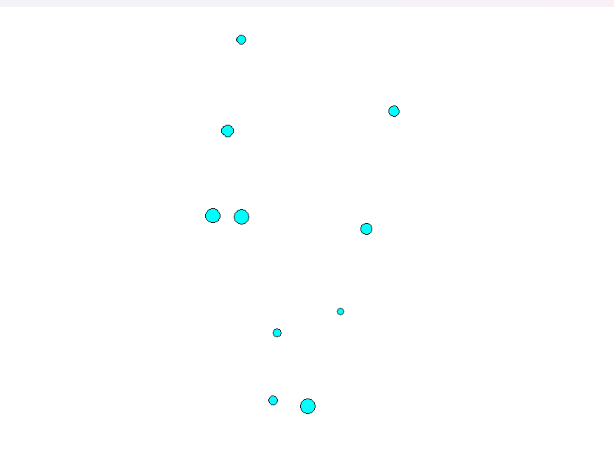

# Particle simulation

A 2D particle simulation in Python. Particles pull on each other with gravity, bounce off each other and stay inside a circular arena.



## How to run

Needs Python 3 (Tkinter comes with Python on Windows and macOS).

```
python main.py
```

Change `n` in `main.py` to get more or fewer particles.

## How it works

- **Gravity:** every particle pulls on every other particle with F = G·m1·m2/r².
- **Collisions:** overlapping particles get pushed apart. The more they overlap, the harder the push.
- **Arena:** particles that leave the circle get pushed back in.
- **Drawing:** positions are converted from simulation coordinates (origin in the middle, y up) to canvas pixels (origin top left, y down). The screen updates 60 times per second.

## Files

- `model.py` – vectors, particles and all the forces
- `view.py` – drawing and the main loop
- `main.py` – sets up the particles and starts the simulation

## Credits

Started as a group project in the course DAT395 Programutveckling at Chalmers, together with:
Manne Laurin
Arvid Möller
Noah Saastad Bäckstrand
Wilmer Dahlskog
